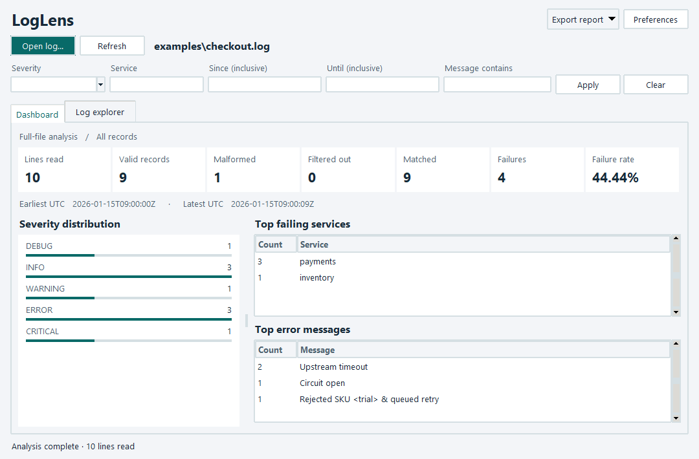
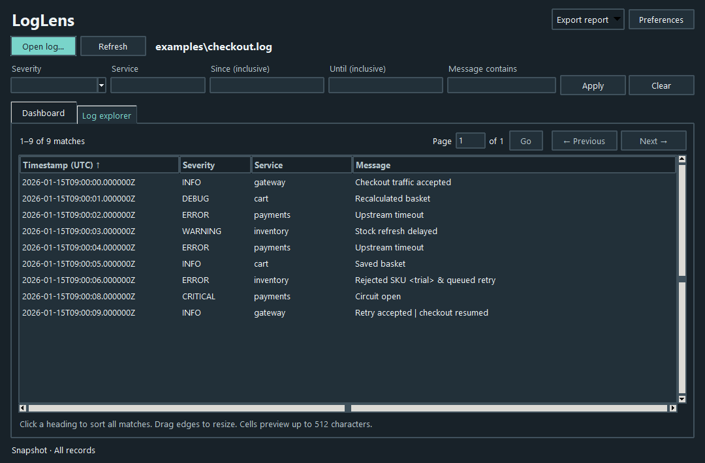

# LogLens — Desktop and command-line log analysis

LogLens scans a UTF-8 application log to show which services failed, which errors recurred, and how many input lines were usable.



- Open a file, filter the entire log, and explore every matching record in sortable pages.
- Compare severity counts, failure rates, service rankings, and UTC time ranges.
- Export JSON or offline HTML from the desktop, or run the same analysis from the CLI.

**Python 3.11+** with Tkinter/ttk and SQLite for the desktop. The streaming parser, filters, and reports are shared by both interfaces. There are no third-party runtime dependencies.

## Quick start

From the repository root, launch the desktop with the included sample:

```console
python -m loglens.gui examples/checkout.log
```

Omit the file argument to start with the **Open log** picker. For terminal output:

```console
python -m loglens examples/checkout.log
```

On Windows, `py -3` can be used in place of `python` when the Python launcher is installed.

## Installation

The quick start runs directly from source. To install the desktop and CLI launchers in a virtual environment on Windows PowerShell:

```powershell
git clone https://github.com/aadarsha-hiremath/loglens-python.git
cd loglens-python
py -3 -m venv .venv
.\.venv\Scripts\python.exe -m pip install .
.\.venv\Scripts\loglens.exe examples/checkout.log
.\.venv\Scripts\loglens-gui.exe examples/checkout.log
```

On macOS or Linux, create the environment with `python3 -m venv .venv`, then run `.venv/bin/python -m pip install .` and `.venv/bin/loglens examples/checkout.log`. Installation uses setuptools at build time. The installed desktop launcher is `loglens-gui`. Both commands use the standard library.

## Using the desktop

1. Choose **Open log** (Ctrl+O). The header shows the selected path. **Refresh** (F5) reads the file again. **Cancel** interrupts a scan or page query.
2. Leave fields blank to include everything. Enter comma-separated severity levels or exact service names, inclusive timezone-aware bounds, or a case-insensitive message substring. Choose **Apply** or press Enter. **Clear** resets the filters and scans again.
3. Read the **Dashboard** for full-file totals. Valid records include both matched and filtered-out records. Severity, failure rate, rankings, and time bounds describe the matched records. For example, filtering the checkout sample to `payments` selects three failures with a 100% failure rate.
4. Open **Log explorer** to page through every match, 100 at a time. Enter a page number and choose **Go** to jump directly to it. Click a heading to sort the complete snapshot and click again to reverse the order. Severity sorts from DEBUG through CRITICAL. Ties retain input order. Cells display up to 512 characters, followed by an ellipsis for longer values. Filtering, sorting, grouping, and export use complete values.
5. Use **Export report** to save the applied dashboard results as JSON or HTML. An export includes summary statistics and selected rankings. Use **Preferences** to choose light or dark appearance, font size, visible columns, or 1–100 top results.



Drag a column edge to resize it or drag the divider between the severity chart and rankings. Window dimensions, divider position, and column widths are saved on normal close. **Reset to defaults** restores the original layout and appearance. Preferences are stored in `%LOCALAPPDATA%\LogLens\desktop.json` on Windows and `$XDG_CONFIG_HOME/LogLens/desktop.json` (default `~/.config/LogLens/desktop.json`) elsewhere. The preferences file contains only settings.

The desktop requires a graphical session and a Python build with Tk. Run `python -m tkinter` to check that Tk opens a window. On Windows, the standard Python installer offers Tcl/Tk support. The CLI runs independently of Tk.

## Input format

Each physical line is one UTF-8 record:

```text
2026-01-15T10:00:04+01:00 | ERROR | payments | Upstream timeout
```

| Field | Accepted values |
| --- | --- |
| Timestamp | `YYYY-MM-DDTHH:MM:SS`, optional 1–6 fractional digits, then `Z` or a signed `HH:MM` offset. Dates and offsets must be valid and convertible to UTC. |
| Severity | `DEBUG`, `INFO`, `WARNING`, `ERROR`, or `CRITICAL`, uppercase in the file. |
| Service | An ASCII letter or digit followed by any number of ASCII letters, digits, underscores, periods, or hyphens. Case-sensitive. |
| Message | Nonblank text. Spaces and additional field delimiters within the message are preserved. |

The separator is a space, a vertical bar, and a space. LF, CRLF, an optional initial UTF-8 BOM, and a final line without a newline are supported. A blank line, malformed record, or line with invalid UTF-8 contributes one rejection reason. Processing continues at the next physical line. Both [sample logs](examples/) contain synthetic data.

## CLI examples

```console
python -m loglens --help
python -m loglens examples/checkout.log --search timeout --format json
python -m loglens examples/checkout.log --level error --level critical --service payments
python -m loglens examples/checkout.log --since 2026-01-15T09:00:02Z --until 2026-01-15T09:00:06Z --top 2
python -m loglens examples/worker.log --format json -o worker.json
python -m loglens examples/checkout.log --format html -o checkout.html
```

Open `checkout.html` in a browser to view the [HTML report example](assets/checkout-report.png). It works offline. Repeated levels or services select any listed value in that category. All supplied categories must match. Time bounds include both endpoints and compare UTC instants. Records can arrive out of order.

## Example output

The checkout sample has 10 lines. One line is malformed. Of the 9 valid records, 4 are failures (44.44%). The terminal ranking reads:

```text
Top failing services
  payments  3
  inventory  1

Top error messages
  Upstream timeout  2
  Circuit open  1
  Rejected SKU <trial> & queued retry  1
```

| Report field | Interpretation |
| --- | --- |
| Lines read | Matched + filtered out + malformed. Rejections are counted before filtering. |
| Failures / failure rate | Matched `ERROR` and `CRITICAL` records, and their percentage of all matched records. An empty selection has a JSON rate of `null`. |
| Earliest / latest UTC | Minimum and maximum timestamps among matched records. Both are `null` for an empty selection. |
| Top failing services | Services ranked by number of matched failures. |
| Top error messages | Exact failure message frequencies across selected services, including singletons. |

Both rankings default to five entries. Ties use ascending, case-sensitive string order. An output file is written as UTF-8 and replaced after a successful write. Its parent directory must exist. Reports go to stdout by default. Exit code `0` means the scan completed, including scans with rejected lines. File or output errors return `1`, and invalid CLI arguments return `2`.

## Tests and benchmark

```console
python -m unittest discover -s tests -v
python -m benchmarks.streaming --rows 100000 --runs 5
```

GitHub Actions runs the suite and an installed-command smoke test on Windows and Linux with Python 3.11 and 3.14. Tests cover parsing, filtering, UTC boundaries, ranking ties, damaged UTF-8, HTML escaping, and output-file replacement.

The following CLI baseline was measured with LogLens 0.1.0. Two independent invocations of the streaming benchmark ran on Windows 11 (build 26300), CPython 3.12.14. Each generated 100,000 records (6,838,205 bytes) across seven services, with an error every tenth record and 31 distinct failure messages.

| Invocation | Five scan times (seconds) | Median rows/s | Peak traced bytes |
| --- | --- | ---: | ---: |
| 1 | 0.231248, 0.222719, 0.229224, 0.262454, 0.223478 | 436,255 | 15,656 |
| 2 | 0.228270, 0.221584, 0.221057, 0.220314, 0.228005 | 451,295 | 15,656 |

Each timed scan opens the file, parses and aggregates it, and checks the row and error totals. Timings exclude dataset generation and report rendering. Throughput divides the row count by the median elapsed time. A separate sixth scan measures Python allocations with `tracemalloc`. Interpreter startup, native allocations outside the tracer, and OS file caches are excluded. These figures describe this synthetic workload. Disk cache state, CPU load, line length, and the number of distinct messages can all affect results.

### Desktop measurements

Run `python -m benchmarks.desktop --rows 250000` in a graphical session. Add `--trace` for a separate Python allocation measurement. Every row is a failure with a unique message. The benchmark opens the actual dashboard, requests a Tk callback every 25 ms, and checks the final record of the last globally sorted page.

Windows 11 (build 26300), CPython 3.12.14, one run per configuration:

| Rows | Allocation tracing | Scan through first displayed page | Largest Tk callback gap | Snapshot bytes | Peak traced Python bytes |
| ---: | --- | ---: | ---: | ---: | ---: |
| 25,000 | On | 0.426 s | 32.3 ms | 1,884,160 | 82,880 |
| 250,000 | On | 3.730 s | 43.3 ms | 19,001,344 | 89,978 |
| 250,000 | Off | 1.254 s | 33.9 ms | 19,001,344 | — |

The untraced 250,000-row input occupied 16,750,000 bytes. The UI dispatched 41 callbacks during the scan and displayed the sorted last page in 0.372 s. Tracing excludes native SQLite/Tk allocations and OS caches. Sorting cost depends on the dataset, selected column, and page depth.

In two additional untraced runs in fresh Windows processes, `GetProcessMemoryInfo` reported lifetime peak working sets of 42,930,176 bytes for 25,000 rows and 43,892,736 bytes for 250,000. These observations include the interpreter, Tk, SQLite, and the sorted last-page query. They describe this workload; longer individual messages can raise the peak.

## Project layout

```text
loglens/                  Parser, filters, aggregation, renderers, desktop and CLI
examples/                 Two synthetic input files
tests/                    Unit and subprocess integration tests
benchmarks/               CLI throughput and live desktop benchmarks
docs/architecture.md      Data flow, complexity, failure handling, and limits
.github/workflows/ci.yml  Windows and Linux test matrix
pyproject.toml            Package metadata and console entry point
```

See the [architecture notes](docs/architecture.md) for design decisions and scaling limits.

## Limitations and future work

LogLens accepts one file with one record per physical line. A single record must fit in memory. The CLI keeps exact failure-key counters in RAM. The desktop stores matched records in a local temporary SQLite database and requires disk space for the snapshot and sort work. Large sorts and deep pages can take longer. The snapshot is removed on normal close. A forced process termination can leave temporary files.

Refresh to see changes after a scan. Rotated-log aggregation and multiline stack traces are possible future extensions.

## License

Copyright © 2026 Aadarsha Hiremath. Distributed under the [MIT License](LICENSE).
