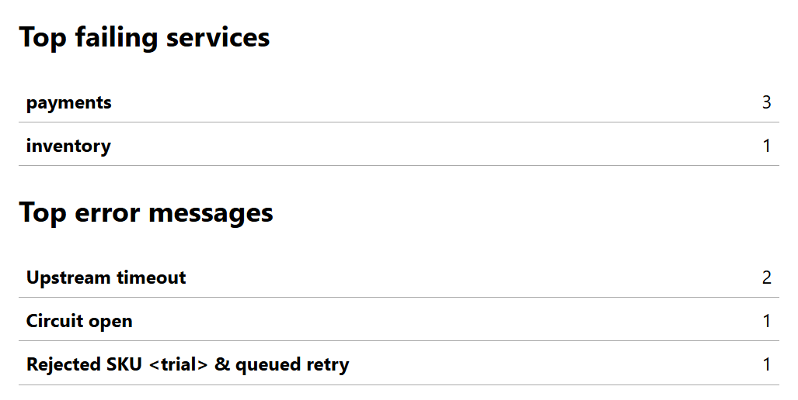

# LogLens — Python Log Analysis Engine

LogLens scans a UTF-8 application log in one pass and reports which services produced the most failures and which messages recurred.



- Filter by severity, service, or an inclusive time window.
- Count failures and rank exact error messages in one pass over the input.
- Write terminal, JSON, or standalone HTML reports with a breakdown of rejected lines.

**Python 3.11+ · standard library.** File iterators stream the input, immutable dataclasses represent records, and hash tables count failures for top-K selection.

**Quick start** from the repository root:

```console
python -m loglens examples/checkout.log
```

On Windows, `py -3` can be used in place of `python` when the Python launcher is installed.

## Installation

The quick start runs directly from source. To install the `loglens` command in a virtual environment on Windows PowerShell:

```powershell
git clone https://github.com/aadarsha-hiremath/loglens-python.git
cd loglens-python
py -3 -m venv .venv
.\.venv\Scripts\python.exe -m pip install .
.\.venv\Scripts\loglens.exe examples/checkout.log
```

Cloning requires access to this private repository. On macOS or Linux, create the environment with `python3 -m venv .venv`, then run `.venv/bin/python -m pip install .` and `.venv/bin/loglens examples/checkout.log`. Installation uses setuptools at build time. The installed command has zero third-party runtime dependencies.

## Input format

Each physical line is one UTF-8 record:

```text
2026-01-15T10:00:04+01:00 | ERROR | payments | Upstream timeout
```

| Field | Accepted values |
| --- | --- |
| Timestamp | `YYYY-MM-DDTHH:MM:SS`, optional 1–6 fractional digits, then `Z` or a signed `HH:MM` offset. Dates and offsets must be valid and convertible to UTC. |
| Severity | `DEBUG`, `INFO`, `WARNING`, `ERROR`, or `CRITICAL`, uppercase in the file. |
| Service | An ASCII letter or digit followed by any number of ASCII letters, digits, underscores, periods, or hyphens. Case-sensitive. |
| Message | Nonblank text. Spaces and additional field delimiters within the message are preserved. |

The separator is a space, a vertical bar, and a space. LF, CRLF, an optional initial UTF-8 BOM, and a final line without a newline are supported. A blank line, malformed record, or line with invalid UTF-8 contributes one rejection reason. Processing continues at the next physical line. Both [sample logs](examples/) contain synthetic data.

## CLI examples

```console
python -m loglens --help
python -m loglens examples/checkout.log --level error --level critical --service payments
python -m loglens examples/checkout.log --since 2026-01-15T09:00:02Z --until 2026-01-15T09:00:06Z --top 2
python -m loglens examples/worker.log --format json -o worker.json
python -m loglens examples/checkout.log --format html -o checkout.html
```

Open `checkout.html` in a browser to see the report pictured above. It works offline. Repeated levels or services select any listed value in that category. All supplied categories must match. Time bounds include both endpoints and compare UTC instants. Records can arrive out of order.

## Example output

The quick start reads 10 lines from the checkout sample. One line is malformed. Of the 9 valid records, 4 are failures (44.44%). The terminal ranking reads:

```text
Top failing services
  payments  3
  inventory  1

Top error messages
  Upstream timeout  2
  Circuit open  1
  Rejected SKU <trial> & queued retry  1
```

| Report field | Interpretation |
| --- | --- |
| Lines read | Matched + filtered out + malformed. Rejections are counted before filtering. |
| Failures / failure rate | Matched `ERROR` and `CRITICAL` records, and their percentage of all matched records. An empty selection has a JSON rate of `null`. |
| Earliest / latest UTC | Minimum and maximum timestamps among matched records. Both are `null` for an empty selection. |
| Top failing services | Services ranked by number of matched failures. |
| Top error messages | Exact failure message frequencies across selected services, including singletons. |

Both rankings default to five entries. Ties use ascending, case-sensitive string order. An output file is written as UTF-8 and replaced after a successful write. Its parent directory must exist. Reports go to stdout by default. Exit code `0` means the scan completed, including scans with rejected lines. File or output errors return `1`, and invalid CLI arguments return `2`.

## Tests and benchmark

```console
python -m unittest discover -s tests -v
python -m benchmarks.streaming --rows 100000 --runs 5
```

GitHub Actions runs the suite and an installed-command smoke test on Windows and Linux with Python 3.11 and 3.14. Tests cover parsing, filtering, UTC boundaries, ranking ties, damaged UTF-8, HTML escaping, and output-file replacement.

Two independent invocations of the benchmark command above ran on Windows 11 (build 26300), CPython 3.12.14. Each generated 100,000 records (6,838,205 bytes) across seven services, with an error every tenth record and 31 distinct failure messages.

| Invocation | Five scan times (seconds) | Median rows/s | Peak traced bytes |
| --- | --- | ---: | ---: |
| 1 | 0.231248, 0.222719, 0.229224, 0.262454, 0.223478 | 436,255 | 15,656 |
| 2 | 0.228270, 0.221584, 0.221057, 0.220314, 0.228005 | 451,295 | 15,656 |

Each timed scan opens the file, parses and aggregates it, and checks the row and error totals. Timings exclude dataset generation and report rendering. Throughput divides the row count by the median elapsed time. A separate sixth scan measures Python allocations with `tracemalloc`. Interpreter startup, native allocations outside the tracer, and OS file caches are excluded. These figures describe this synthetic workload. Disk cache state, CPU load, line length, and the number of distinct messages can all affect results.

## Project layout

```text
loglens/                  Parser, filters, aggregation, report renderers, CLI
examples/                 Two synthetic input files
tests/                    Unit and subprocess integration tests
benchmarks/streaming.py    Deterministic generator and measurement driver
docs/architecture.md      Data flow, complexity, failure handling, and limits
.github/workflows/ci.yml  Windows and Linux test matrix
pyproject.toml            Package metadata and console entry point
```

See the [architecture notes](docs/architecture.md) for design decisions and scaling limits.

## Limitations and future work

LogLens accepts one file with one record per line. Exact counts retain every distinct failure message and failing service, even with `--top 1`. Logs containing a different request ID in every message can therefore consume more memory than the benchmark corpus.

A useful next benchmark would vary message cardinality at a fixed row count. Support for rotated logs would let a single report cover an incident spanning multiple files.

## License

Copyright © 2026 Aadarsha Hiremath. Distributed under the [MIT License](LICENSE).
